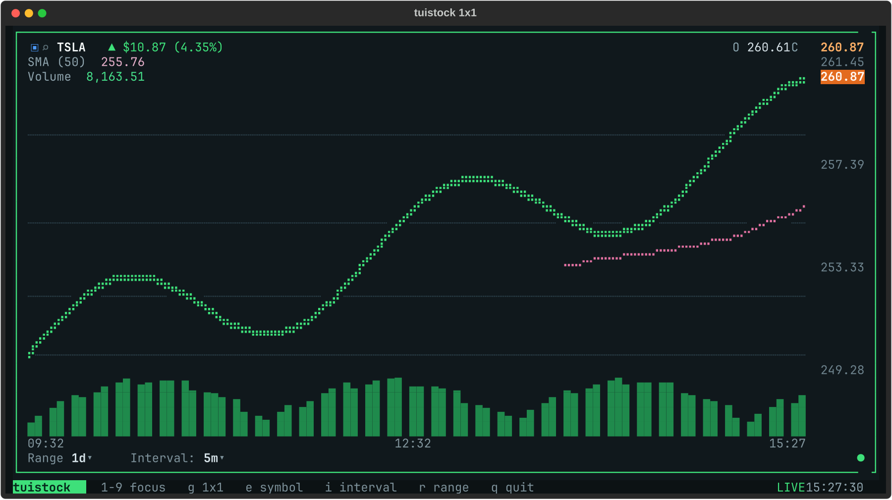
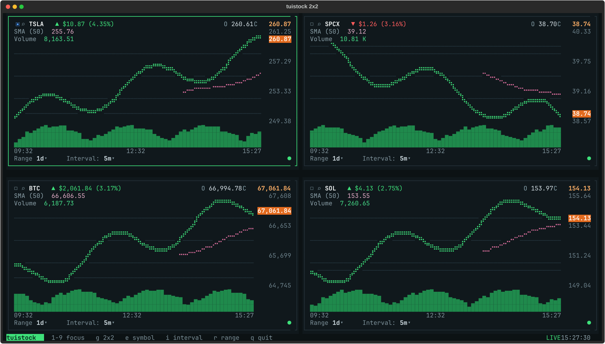
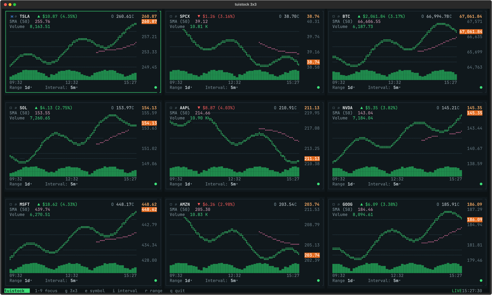
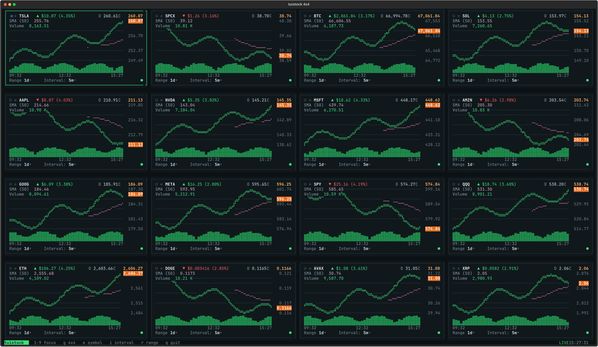

# tuistock

Realtime stock and crypto charts in the terminal. Choose a 1×1, 2×2, 3×3, or 4×4 grid. The default 2×2 grid shows TSLA, SPCX, BTC, and SOL.

## Quick start

```bash
uv run tuistock
```

## Layouts

Press `g` while the app is running to cycle through **1×1 → 2×2 → 3×3 → 4×4 → 1×1**. The status bar shows the current grid size. You can also select a layout at startup:

| Layout | Visible charts | Startup command |
| --- | ---: | --- |
| 1×1 | 1 | `uv run tuistock --layout 1x1` |
| 2×2 | 4 | `uv run tuistock --layout 2x2` |
| 3×3 | 9 | `uv run tuistock --layout 3x3` |
| 4×4 | 16 | `uv run tuistock --layout 4x4` |

Your grid size is saved for the next launch. Shrinking the grid keeps hidden panels' symbols, intervals, and ranges, so expanding it restores your watchlist. Only visible panels receive polling and live subscription updates. Larger grids work best in a wider, taller terminal.

### Screenshots

These screenshots show the app rendering sample price and volume data to illustrate each layout.

**1×1 — one chart**



**2×2 — four charts (default)**



**3×3 — nine charts**



**4×4 — sixteen charts**



## Controls

| Key | Action |
| --- | --- |
| `g` | Cycle the layout |
| `1`–`9` | Focus one of the first nine visible panels |
| Arrow keys or `h`, `j`, `k`, `l` | Move focus within the grid |
| Tab / Shift+Tab | Move through every visible panel |
| `e` | Edit the focused panel's symbol, e.g. `AAPL`, `ETH`, or `BTC-USD` |
| Enter / Escape | Save / cancel a symbol edit |
| `i` | Cycle the focused panel's interval |
| `r` | Cycle the focused panel's range |
| `q` | Quit |

## Watchlist and saved settings

```bash
uv run tuistock --symbols AAPL,ETH,NVDA,SPY
uv run tuistock --layout 1x1 --symbols BTC
uv run tuistock --layout 3x3 --symbols TSLA,SPCX,BTC,SOL,AAPL,NVDA,MSFT,AMZN,GOOG
uv run tuistock --layout 4x4
uv run tuistock --reset
```

`--symbols` accepts up to 16 tickers in row order. `--reset` restores the default symbols and 2×2 grid; combine it with `--layout` to start fresh at another size.

The grid size and all 16 panel settings are saved in `~/.config/tuistock/layout.json` (or under `$XDG_CONFIG_HOME` when set). Existing four-panel configuration files open as 2×2 grids.

## Market data

With Alpaca API keys configured, US stocks quote through Alpaca's official Market Data API (real-time IEX feed): batched snapshots for live prices, historical bars for candles. Crypto uses Coinbase candles and the live trade feed.

Without keys — or for tickers Alpaca doesn't cover, like international exchanges — stocks fall back to Yahoo candles and Nasdaq realtime quotes, so the app works out of the box. Multi-day stock charts use daily bars.

### Alpaca API keys (recommended)

Alpaca is the more reliable and better-behaved source: an official API with no bot-protection to trip, and one batched request per poll covers the whole grid. The free plan's 200 req/min limit comfortably fits even a 4×4 layout.

1. Sign up at [app.alpaca.markets](https://app.alpaca.markets) (a paper-trading account is fine).
2. Generate an API key on the dashboard (**API Keys → Generate New Key**). The secret is shown only once.
3. Save the keys to `~/.config/tuistock/alpaca.json`:

   ```bash
   mkdir -p ~/.config/tuistock
   cat > ~/.config/tuistock/alpaca.json <<'EOF'
   {"key_id": "YOUR_KEY_ID", "secret_key": "YOUR_SECRET_KEY"}
   EOF
   chmod 600 ~/.config/tuistock/alpaca.json
   ```

   Alternatively, export `APCA_API_KEY_ID` and `APCA_API_SECRET_KEY` (Alpaca's native names, also read: `ALPACA_API_KEY_ID`/`ALPACA_API_SECRET_KEY`).

Invalid keys turn Alpaca off for the rest of the session. An unreachable API (dropped connection, silent firewall) puts it on a 60-second cooldown instead — the fallback feeds take over immediately, and Alpaca is retried when the cooldown expires.

## Tests

```bash
uv run python -m unittest discover -s tests -v
```

The layout regression tests use Textual's headless test runner and do not contact market services.
