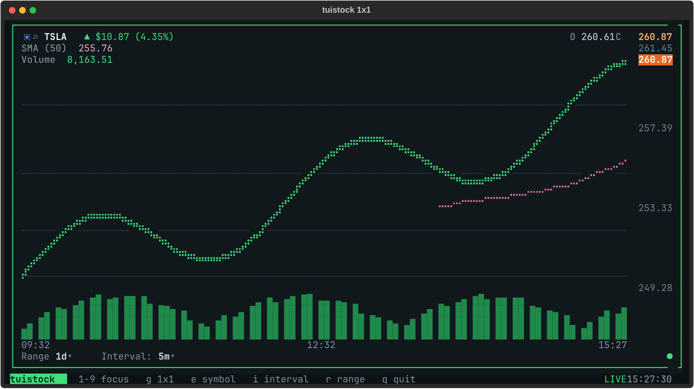
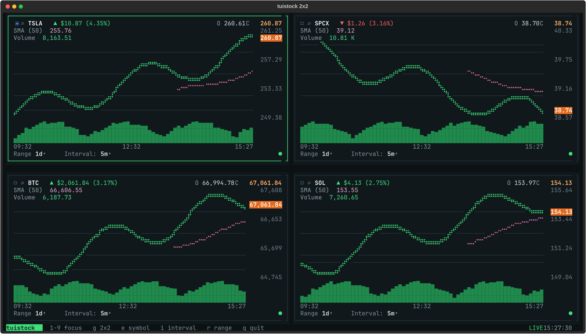
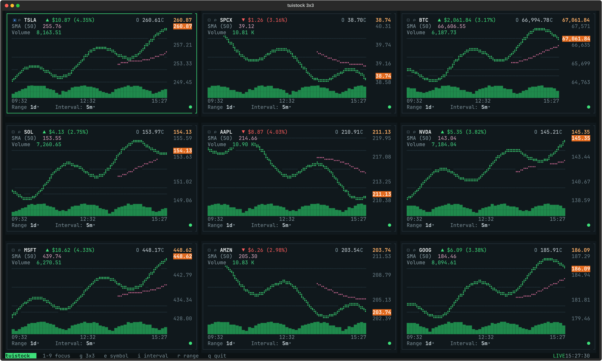
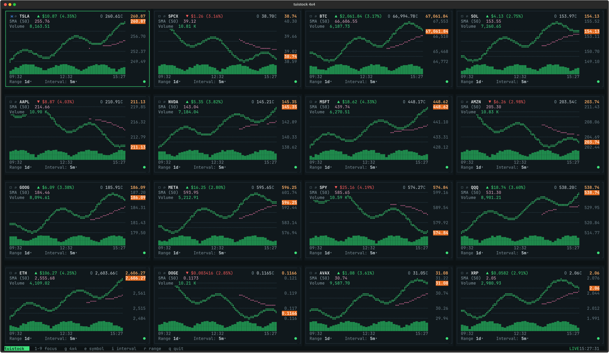

# tuistock

Realtime stock and crypto charts in the terminal. Choose a 1×1, 2×2, 3×3, or 4×4 grid. The default 2×2 grid shows TSLA, SPCX, BTC, and SOL.

## Quick start

```bash
uv run tuistock
```

## Layouts

Press `g` while the app is running to cycle through **1×1 → 2×2 → 3×3 → 4×4 → 1×1**. The status bar shows the current grid size. You can also select a layout at startup:

| Layout | Visible charts | Startup command |
| --- | ---: | --- |
| 1×1 | 1 | `uv run tuistock --layout 1x1` |
| 2×2 | 4 | `uv run tuistock --layout 2x2` |
| 3×3 | 9 | `uv run tuistock --layout 3x3` |
| 4×4 | 16 | `uv run tuistock --layout 4x4` |

Your grid size is saved for the next launch. Shrinking the grid keeps hidden panels' symbols, intervals, and ranges, so expanding it restores your watchlist. Only visible panels receive polling and live subscription updates. Larger grids work best in a wider, taller terminal.

### Screenshots

These screenshots show the app rendering sample price and volume data to illustrate each layout.

**1×1 — one chart**



**2×2 — four charts (default)**



**3×3 — nine charts**



**4×4 — sixteen charts**



## Controls

| Key | Action |
| --- | --- |
| `g` | Cycle the layout |
| `1`–`9` | Focus one of the first nine visible panels |
| Arrow keys or `h`, `j`, `k`, `l` | Move focus within the grid |
| Tab / Shift+Tab | Move through every visible panel |
| `e` | Edit the focused panel's symbol, e.g. `AAPL`, `ETH`, or `BTC-USD` |
| Enter / Escape | Save / cancel a symbol edit |
| `i` | Cycle the focused panel's interval |
| `r` | Cycle the focused panel's range |
| `q` | Quit |

## Watchlist and saved settings

```bash
uv run tuistock --symbols AAPL,ETH,NVDA,SPY
uv run tuistock --layout 1x1 --symbols BTC
uv run tuistock --layout 3x3 --symbols TSLA,SPCX,BTC,SOL,AAPL,NVDA,MSFT,AMZN,GOOG
uv run tuistock --layout 4x4
uv run tuistock --reset
```

`--symbols` accepts up to 16 tickers in row order. `--reset` restores the default symbols and 2×2 grid; combine it with `--layout` to start fresh at another size.

The grid size and all 16 panel settings are saved in `~/.config/tuistock/layout.json` (or under `$XDG_CONFIG_HOME` when set). Existing four-panel configuration files open as 2×2 grids.

## Market data

Stocks use Nasdaq's realtime quotes, and Yahoo candles when that feed is available so the volume bars can draw. Crypto uses Coinbase candles and the live trade feed. Multi-day stock charts use daily bars.

## Tests

```bash
uv run python -m unittest discover -s tests -v
```

The layout regression tests use Textual's headless test runner and do not contact market services.
